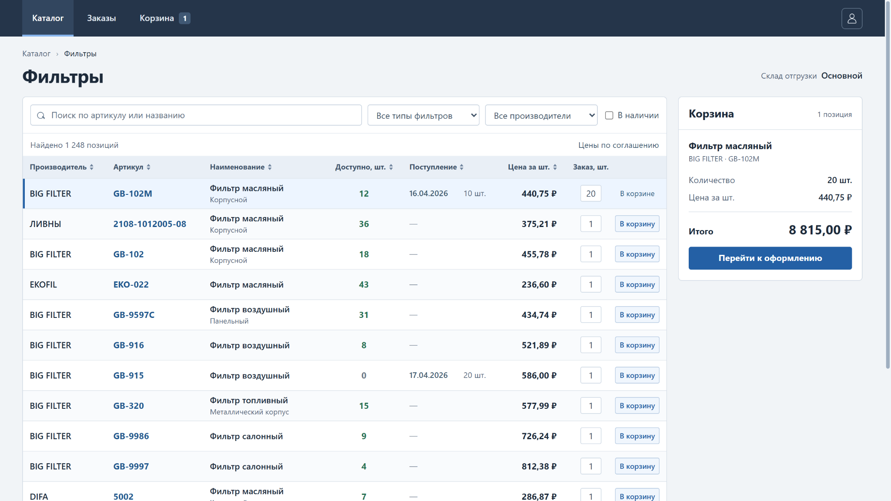

# B2B-кабинет для автосервисов с интеграцией в 1С

Разработал для оптового поставщика автозапчастей кабинет, через который автосервисы заказывают фильтры и расходники. Раньше менеджер проверял цены и наличие в 1С и вручную оформлял каждый заказ. Теперь закупщик сам собирает корзину по ценам своей компании, выбирает отгрузку целиком или частями и видит, сколько товара склад уже отгрузил.

Кабинет реализован и запущен. Экраны воссозданы для портфолио, данные на них условные.

## Мой вклад

- **Кабинет на React.** Сделал авторизацию, каталог с поиском по артикулу, корзину и карточку заказа. На экране оформления закупщик сравнивает графики отгрузки. При перезагрузке страницы кабинет восстанавливает статус по данным API.
- **API заказов на NestJS (Node.js, TypeScript).** Сервер проверяет, что оформление принадлежит компании пользователя. Согласие закупщика и задание на отправку в 1С сохраняются в одной транзакции PostgreSQL. После перезапуска обработчик может продолжить отправку.
- **Интеграция с 1С:УТ 11.5.** Подключил HTTP-сервис, через который бэкенд запрашивает цены и наличие к каждой дате отгрузки. В 1С создаётся заказ и резервируется товар. Оттуда же кабинет получает сведения о фактических отгрузках.

[Оформление заказа](Case_01_initial_checkout_anonymized.png) · [Сравнение графиков отгрузки](Case_01_requote_anonymized.png) · [Карточка заказа после первой отгрузки](Case_01_order_shipments_anonymized.png)

## Как подтверждается заказ

У кабинета и менеджера общий склад. Если менеджер зарезервировал два из 12 фильтров первой партии, закупщику нужно решить, готов ли он получить их позже. Кабинет показывает прежний и новый графики рядом и ждёт подтверждения новых условий.

Отдельно проверили потерю ответа после создания заказа в 1С. Команду отправили повторно с прежним `confirmationId`. В 1С остался один заказ, и закупщик увидел его номер в кабинете.

[Заказ на 20 фильтров](technical-details.md#заказ-на-20-фильтров) · [Архитектура и контракт API](technical-details.md#как-устроено-оформление) · [Проверка интеграции](technical-details.md#проверка-интеграции)
