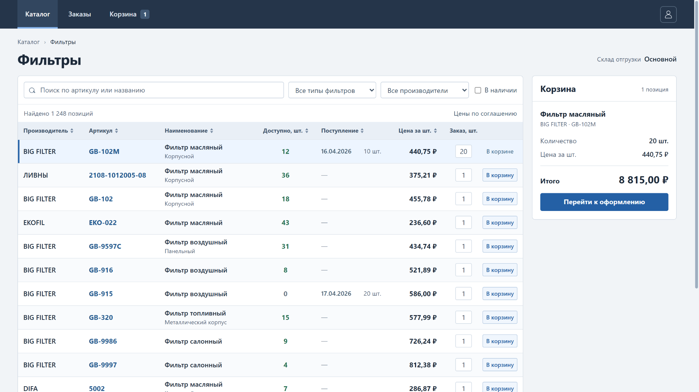
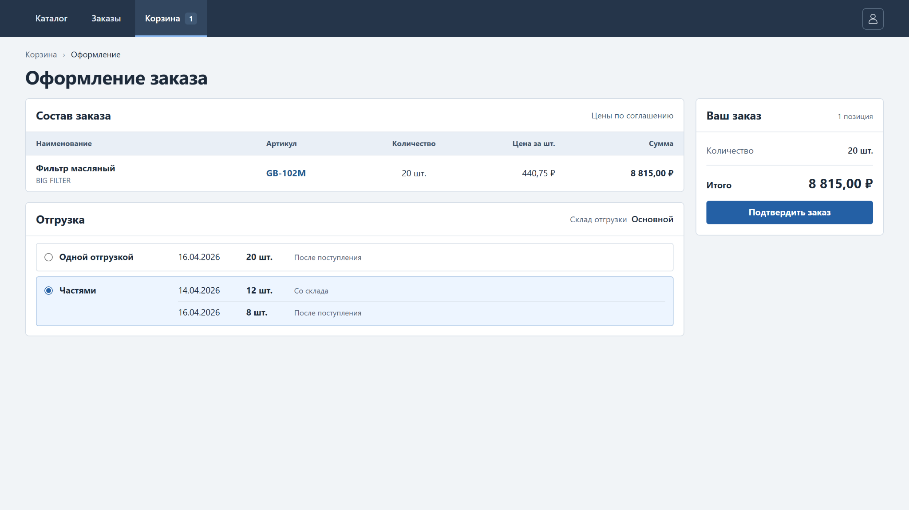
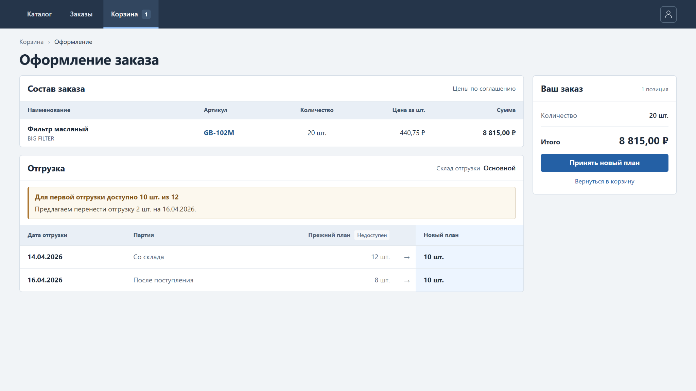
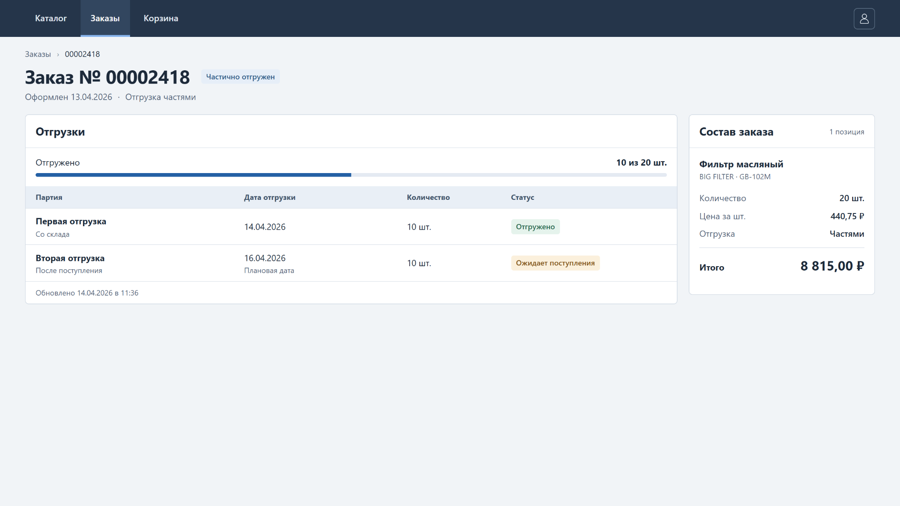

# Как B2B-кабинет оформляет заказ в 1С

[Кратко о проекте](README.md) · [Архитектура и API](#как-устроено-оформление) · [Проверка интеграции](#проверка-интеграции)

Кабинетом пользуются оптовые клиенты одного поставщика автозапчастей. Заказы из кабинета отгружаются с одного склада. Соглашения с клиентами, остатки, ожидаемые поступления и заказы ведутся в одной базе 1С:УТ 11.5. Когда менеджер резервирует товар вручную, меняется и доступное для кабинета количество.

## Заказ на 20 фильтров

На обезличенных экранах закупщик пополняет запас автосервиса и оформляет заказ 13.04.2026. В корзине 20 масляных фильтров BIG FILTER GB-102M по 440,75 ₽, всего 8 815 ₽. На складе свободны 12 штук, ещё 10 ожидаются 16.04.2026. Расчёт показывает доступность на момент запроса. Товар со склада 1С резервирует при создании заказа.

**Первый план.** Под составом заказа кабинет показывает два варианта отгрузки с датами и количеством. Одной отгрузкой поставщик может отправить все 20 фильтров 16.04.2026 после поступления. При отгрузке частями первые 12 фильтров можно отправить 14.04.2026, ещё 8 — 16.04.2026.

Закупщик выбирает «Частями» и нажимает «Подтвердить заказ». Backend сохраняет согласие и задание на отправку, а кабинет показывает «Принято в обработку». Фоновый обработчик (воркер) отправляет в 1С запрос на создание заказа по принятым условиям. Далее `C1` — условное обозначение команды для первого согласованного графика. Её идентификатор передаётся в поле `confirmationId`.

**Изменение графика.** До обработки `C1` менеджер резервирует два фильтра для другого заказа. На 14.04.2026 остаётся 10 свободных штук. 1С отклоняет `C1` без создания заказа и резерва. Backend запрашивает новый расчёт для отгрузки частями. В первом плане для второй отгрузки требовались 8 из 10 ожидаемых фильтров. Теперь для неё нужны все 10.

Прежний план `12+8` уже недоступен. Кабинет показывает его для сравнения в блоке «Отгрузка». Подтвердить можно только `10+10` — 10 фильтров 14.04.2026 и 10 фильтров 16.04.2026. Цена прежняя, два фильтра переходят из первой партии во вторую. Если новый график не подходит, закупщик может вернуться в корзину без подтверждения. Следующую команду backend отправит только после его согласия.

**Создание заказа.** Закупщик нажимает «Принять новый план». Backend отправляет команду для нового графика — `C2` со своим `confirmationId`. 1С создаёт один заказ на 20 фильтров, резервирует 10 со склада и выделяет под этот заказ ещё 10 из ожидаемого поступления.

**Потерянный ответ.** В этом примере связь обрывается после записи заказа в 1С. Кабинет показывает «Уточняем подтверждение». Воркер ищет результат по `confirmationId` отправленной команды. При необходимости он повторяет `C2` с тем же идентификатором и данными. 1С возвращает номер уже созданного заказа.

**Две отгрузки.** На карточке заказа № 00002418 от 13.04.2026 виден статус «Частично отгружен». Склад отгрузил 10 фильтров 14.04.2026. Ещё 10 ожидаются из поступления, плановая дата второй отгрузки — 16.04.2026. После её проведения в 1С кабинет показывает 20 из 20.

Условие об оплате в примере

Предположим, что по соглашению действует 100% предоплата до первой отгрузки. После создания заказа поставщик выставляет один счёт на 8 815 ₽ за все 20 фильтров. Автосервис перечисляет деньги со своего расчётного счёта. Поставщик отражает платёж в 1С по банковской выписке. После этого склад может отгрузить первую партию по согласованному графику.

## Как устроено оформление

### Согласование заказа в React

При подтверждении кабинет передаёт `quoteRevision` выбранного графика. В первом расчёте для отгрузки частями сохранён план `12+8` — 12 фильтров на 14.04.2026 и 8 на 16.04.2026. По `checkoutId` и этой версии NestJS находит в PostgreSQL график, который принял закупщик.

После нажатия «Подтвердить заказ» React блокирует повторную отправку с кнопки. Ответ `202 Accepted` означает, что backend сохранил согласие и задание на отправку. Кабинет показывает «Принято в обработку» и запрашивает состояние конкретного оформления через `GET /api/checkouts/{checkoutId}`.

Например, `GET /api/checkouts/ch_42` возвращает текущий расчёт и последнее подтверждение с идентификатором команды, версией, статусом и принятыми условиями. При переходе с `12+8` на `10+10` оформление сохраняет прежний `checkoutId`. Номер заказа присваивает 1С при создании документа.

Если ответ на `POST` потерялся **между браузером и backend**, кабинет показывает «Проверяем отправку» и читает состояние с сервера. До сверки отправленная версия хранится в `sessionStorage`. После перезагрузки кабинет берёт ID оформления из адреса и возобновляет проверку. Если в другой вкладке уже приняли новый расчёт, обе вкладки показывают последнее подтверждение после обновления данных.

Кабинет может повторить `POST` для отправленной версии, пока она остаётся текущей, доступна для подтверждения и записи о согласии ещё нет. При `409 Conflict` кабинет перечитывает состояние. Если связь прервалась **между backend и 1С**, исход выясняет воркер. До сверки кабинет показывает «Уточняем подтверждение». После окончательного отказа 1С кнопка «Принять новый план» отправляет версию обновлённого расчёта. Если обеспечить весь объём нельзя, кабинет показывает «Передано менеджеру».

### Что сохраняет backend

Backend определяет компанию по сессии пользователя. Для каталога и расчёта он использует цены из её соглашения в 1С. При чтении и подтверждении проверяет, что оформление принадлежит этой компании.

| Поле | Что означает |
|---|---|
| `checkoutId` | Идентификатор всего оформления. Сохраняется при пересчёте. С одним оформлением в 1С можно связать один заказ. |
| `quoteRevision` | Версия расчёта для выбранного варианта отгрузки внутри оформления. По ней backend находит состав корзины, цены, количества по датам и срок действия расчёта. |
| `confirmationId` | Идентификатор команды по принятой версии. У `C1` и `C2` разные идентификаторы. Сетевые повторы одной команды используют её прежний ID. |

Состав и условия сохранённой версии неизменяемы. Изменение корзины требует нового расчёта. Срок действия ограничивает приём нового согласия. После фиксации согласия воркер может отправить или повторить команду и по истечении этого срока. Он передаёт исходные условия. Их выполнимость 1С проверяет перед созданием заказа.

После пересчёта у плана `10+10` своя версия. Например, если это версия 2, по кнопке «Принять новый план» кабинет отправляет `POST /api/checkouts/ch_42/confirmations` с телом `{"quoteRevision": 2}`. Backend проверяет доступ к оформлению и блокирует его запись в транзакции PostgreSQL. Обновление корзины и смена текущей версии расчёта используют ту же блокировку.

1. Если для присланной версии уже есть подтверждение, API возвращает тот же `confirmationId` и его статус. Повтор работает и после истечения срока расчёта.
2. Для новой команды backend проверяет, что версия текущая, состав корзины совпадает с расчётом и срок действия ещё не истёк. Предыдущая команда должна отсутствовать или иметь окончательный статус `REJECTED`. Если какое-либо условие не выполнено, API возвращает `409 Conflict`.
3. В одной транзакции backend фиксирует, кто и когда принял условия, создаёт команду и задание на отправку. После фиксации транзакции API возвращает `202 Accepted` с `confirmationId`. Ограничение уникальности в PostgreSQL допускает одно подтверждение для каждой пары `checkoutId` и `quoteRevision`.

Запись задания вместе с согласием позволяет восстановить отправку, даже если процесс остановился сразу после ответа браузеру. Воркер атомарно берёт задание в работу на ограниченное время. У каждого захвата свой идентификатор. Вызов 1С выполняется вне транзакции PostgreSQL. Если воркер остановился, после истечения срока другой воркер подхватывает то же задание и сверяет исход по прежнему `confirmationId`.

Воркер сопоставляет ответ 1С с условиями исходной команды. Статус подтверждения и состояние задания он обновляет одной транзакцией с проверкой идентификатора и срока захвата. Так запоздавший ответ прежнему воркеру не перезапишет результат нового.

### Контракт HTTP-сервиса 1С

По контракту обмена 1С хранит в журнале команд исход и принятые условия по уникальному `confirmationId`. При обработке сервис блокирует оформление по `checkoutId` до конца транзакции и ищет запись команды. При повторе сверяются `checkoutId`, `quoteRevision`, состав заказа, цены и количества по датам отгрузки. Если данные совпадают, сервис возвращает сохранённый исход до новой проверки остатков. Расхождение требует сверки. При конфликте уникального ключа во время записи транзакция откатывается целиком.

Для новой команды обработчик проверяет, есть ли заказ по `checkoutId`. Если заказ уже связан с оформлением, а результата текущей команды нет, обработчик передаёт `erpOrderId` найденного заказа для сверки.

Для оформления без связанного заказа обработчик проверяет цены по соглашению и доступность согласованного количества к каждой дате отгрузки. При успехе 1С фиксирует заказ, резерв, обеспечение отложенной части, связь с `checkoutId` и результат команды одной транзакцией.

Если цена изменилась или согласованного количества к дате отгрузки не хватает, 1С сохраняет окончательный отказ и его причину по `confirmationId` в транзакции проверки условий. После фиксации возвращает `REJECTED`. Повтор `C1` возвращает сохранённый отказ, даже если товар снова есть на складе.

Блокировка по `checkoutId` защищает одно оформление от повторного создания заказа. У менеджера в 1С может быть другой заказ на те же последние две штуки. В таком случае проверка доступности и распределение товара из общего запаса требуют совместимых блокировок в обоих путях оформления. То же условие действует для одного ожидаемого поступления. Если последние две штуки закреплены за первым заказом, при обработке второго 1С должна увидеть уменьшившееся свободное количество.

### Результат подтверждения

| Исход обмена с 1С | Действие backend |
|---|---|
| `CONFIRMED` с `erpOrderId` и `orderNumber`. Заказ создан. | Сохраняет связь с документом 1С и отдаёт номер заказа кабинету. |
| Сбой связи, тайм-аут или `NOT_FOUND` при поиске результата. Исход пока неизвестен. | Оставляет статус «Уточняем подтверждение». Ищет результат по прежнему `confirmationId` и при необходимости повторяет команду с тем же ID и данными. |
| `REJECTED` с причиной. Команда окончательно отклонена без создания заказа и резерва. | Запрашивает новый расчёт. При выполнимом плане на весь объём создаёт новую команду для того же оформления после согласия покупателя. Если обеспечить весь объём нельзя, передаёт заявку менеджеру. |
| Найден заказ по `checkoutId` без результата текущей команды или параметры по `confirmationId` расходятся в 1С и PostgreSQL. | Передаёт оформление на ручную сверку. Кабинет показывает «Уточняем подтверждение» и блокирует новое подтверждение до выяснения исхода. |

Если автоматические повторы исчерпаны, оформление также передаётся на ручную сверку. Сотрудник сверяет исход в 1С. Если сверка подтверждает связь заказа с `checkoutId` и совпадение с принятыми условиями, backend завершает подтверждение с номером этого заказа. Для повторной отправки сотрудник использует исходную команду с прежним `confirmationId`.

### Отгрузки и изменения

Результат создания заказа хранится отдельно от текущего исполнения. Фоновый обработчик сверяет с 1С отгруженное, оставшееся и отменённое количество по каждой строке. При сбое связи кабинет показывает последние известные данные и время успешной сверки. Менеджер согласует перенос даты или отмену остатка, а кабинет отражает изменения после обновления из 1С.

## Проверка интеграции

**Результат прогона с потерей ответа.** 1С записала заказ по `C2`. После потери ответа команду повторили с тем же `confirmationId`. В 1С по этому оформлению остался один заказ, и его номер совпал с номером в кабинете.

### Сценарии проверки и ожидаемые результаты

| Условия проверки | Ожидаемый результат |
|---|---|
| **Две отгрузки.** Оформить 20 фильтров по плану `10+10`. Провести в 1С первую отгрузку, затем поступление и вторую отгрузку. | Кабинет показывает цену по соглашению и номер заказа из 1С. После каждой сверки счётчик обновляется — сначала 10 из 20, затем 20 из 20. |
| **Цены и доступ.** Открыть один артикул от двух компаний с разными соглашениями. Попытаться прочитать и подтвердить чужое оформление. | Каждая компания видит свою цену. API отклоняет обе операции с чужим оформлением. |
| **Ответ 1С потерян.** После записи заказа по `C2` оборвать ответ и остановить воркер до обновления PostgreSQL. Проверить восстановление с доступным и недоступным поиском результата. | После истечения срока захвата воркер находит исход или повторяет ту же `C2`. В PostgreSQL одна команда для принятой версии. В 1С один заказ, 10 штук в резерве и 10 обеспечены поступлением. В кабинете исходный номер. |
| **Конкуренция за запас.** Оформить одновременно заказ из кабинета и ручной заказ в 1С на последние две штуки к одной дате. Повторить отдельно для остатка на складе и для будущего поступления. | В каждом случае обе штуки получает только один заказ. Второй учитывает уменьшение свободного количества. |
| **Новый график.** Перезагрузить страницу во время сверки `C1`. После окончательного отказа проверить два варианта — доступно `10+10` или поступление отменено и весь объём недоступен. | При сверке виден статус «Уточняем подтверждение», кнопка заблокирована. Для `10+10` кабинет ждёт нового согласия. При нехватке товара показывает «Передано менеджеру». |
| **Повтор после отказа.** Повторить неизменённую `C1` во время записи отказа и ещё раз после восстановления остатка. | Оба повтора возвращают исходный `REJECTED` с причиной. По `C1` заказ и резерв не появляются. |
| **Заказ найден без результата команды.** По `checkoutId` уже есть заказ в 1С. Результата по переданному `confirmationId` нет. | Оформление уходит на ручную сверку. После подтверждения совпадения условий кабинет показывает номер найденного заказа. |
| **Один ID, разные условия.** После записи `C2` отправить повтор с изменённым планом. Отдельно проверить ответ на поиск команды, в котором условия расходятся с PostgreSQL. | Изменённый повтор получает конфликт. В обоих случаях требуется ручная сверка, в 1С сохраняется заказ на исходных условиях. |
| **Две вкладки.** Попробовать впервые подтвердить устаревшую версию или принять новую, пока исход `C1` неизвестен. Отдельно потерять ответ в первой вкладке, дождаться отказа и принять новый план во второй. | В первых двух случаях API возвращает `409 Conflict`. После восстановления связи первая вкладка видит состояние `C2`. Повтор запроса для уже принятой версии возвращает прежний ID без нового задания. |
| **Сбой между браузером и API.** В одном прогоне запрос не дошёл до backend и связь восстановлена до истечения срока расчёта. В другом ответ потерялся после фиксации согласия, а связь восстановлена позже срока. | В первом случае кабинет повторяет запрос для той же версии, во втором получает сохранённый статус. Для версии в PostgreSQL одна команда и одно задание. |
